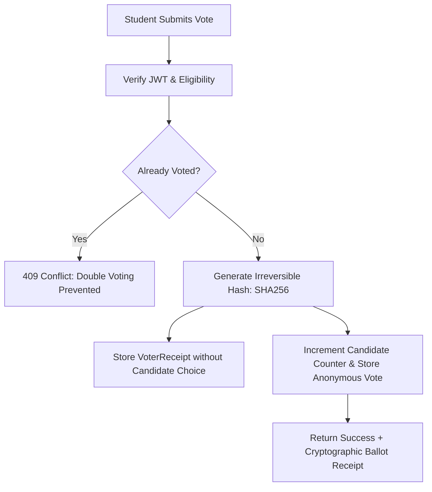

# 🗳️ Digital Voting Machine (DVM) — Student & Class Elections

> **A production-grade, cryptographically secure online voting web application tailored for student council, Class Monitor, and Class Representative (CR) elections. Featuring a modern Cyber-Elegance dark aesthetic and integrated with Google Gemini 2.0 / 1.5 Flash.**

---

## 🌟 Key Features

### 1. 🎨 Cyber-Elegance Dark UI/UX
- **Deep OLED Dark Background**: `#09090b` / `#030712` accented by subtle purple (`#818cf8`) and cyan (`#22d3ee`) ambient radial glows.
- **Brand Identity**: Glowing rounded purple badge with a voting ballot icon, complemented by the brand text `Digital` (white) + `Voting` (neon purple `#818cf8`) + `Machine` (white).
- **Navigation**: Quick pill buttons for `Vote`, `Results`, and Theme Toggle (`Sun`/`Moon`).
- **Hero Section**: `☆ FULLY SECURED VOTING` centered pill badge, massive gradient typography, and a prominent `Login / Signup →` glowing CTA.
- **Open Elections Feed**: Sleek card layout displaying candidates with profile avatars, slogans, manifestos, live status badges, and vote radio selection.

### 2. 🤖 Google Gemini AI Integrations
- **AI Manifesto Summarizer**: Distills complex nominee manifestos into 3 concise, high-impact promises.
- **Unbiased Multi-Candidate Comparison**: Side-by-side analysis contrasting candidates' core agendas without institutional bias.
- **Student Election Proctor Chatbot**: Floating AI widget answering student questions about ballot secrecy, voting deadlines, and candidate platforms in real time.
- **60-Second Campaign Speech Generator**: Assists nominees in drafting friendly, inspiring classroom speeches for candidate pitches.
- **Gemini Fraud & Anomaly Sentinel**: Analyzes ballot submission timestamp distributions to flag automated spam or bot attacks.

### 3. 🛡️ Cryptographic Ballot Secrecy & Integrity
- **Decoupled Anonymity**: The system splits voter verification from ballot tallying. When a vote is cast, an irreversible hash receipt is generated:
  $$\text{Receipt} = \text{SHA-256}(\text{Student ID} + \text{Election Secret})$$
- **Zero Double-Voting**: Atomic database transactions guarantee that each student can submit exactly one ballot per election.
- **Public Audit Ledger**: Students receive a cryptographic proof receipt verifying their ballot was recorded without revealing which candidate they selected.

---

## 📁 Directory Tree

```
dvm/
├── prisma/
│   └── schema.prisma              # Complete database schema (PostgreSQL / SQLite)
├── server/
│   ├── src/
│   │   ├── controllers/
│   │   │   ├── aiController.ts    # Gemini API handlers (Summary, Compare, Bot, Pitch)
│   │   │   ├── authController.ts  # JWT login, registration & RBAC
│   │   │   └── electionController.ts # Atomic voting, tallying & Sentinel audit
│   │   ├── middleware/
│   │   │   └── authMiddleware.ts  # Token verification & role authorization
│   │   ├── routes/
│   │   │   ├── aiRoutes.ts        # AI API routes
│   │   │   ├── authRoutes.ts      # Auth endpoints
│   │   │   └── electionRoutes.ts  # Voting & results endpoints
│   │   ├── services/
│   │   │   └── geminiService.ts   # Google Gemini 1.5 Flash service & fallbacks
│   │   ├── db.ts                  # In-memory atomic store pre-seeded with demo data
│   │   └── index.ts               # Express application entrypoint
│   ├── package.json
│   └── tsconfig.json
├── client/
│   ├── src/
│   │   ├── components/
│   │   │   ├── AuthModal.tsx      # Student/Admin sign-in with 1-click demo accounts
│   │   │   ├── GeminiAssistantModal.tsx # Floating AI chat proctor
│   │   │   ├── HeroSection.tsx    # Cyber-elegance hero header & glowing CTA
│   │   │   ├── ManifestoModal.tsx # AI 3-point summary & multi-nominee comparison
│   │   │   ├── Navbar.tsx         # Brand logo, Vote/Results pills & theme toggle
│   │   │   ├── OpenElectionsCard.tsx # Active election card & candidate cards
│   │   │   ├── PitchGeneratorModal.tsx # 60-second speech creator
│   │   │   └── ResultsModal.tsx   # Live standing bar charts & Fraud Sentinel audit
│   │   ├── App.tsx                # Client orchestration & confetti feedback
│   │   ├── main.tsx               # React 18 DOM mount
│   │   └── index.css              # Tailwind CSS styles & gradient utilities
│   ├── index.html
│   ├── package.json
│   ├── tsconfig.json
│   └── vite.config.ts
├── .env.example
├── package.json                   # Root monorepo execution scripts
└── README.md
```

---

## 🚀 Quickstart Guide

### 1. Prerequisites
- **Node.js**: v18.0.0 or higher
- **npm** or **pnpm**
- **Google Gemini API Key** (Optional for local testing; intelligent fallbacks are included)

### 2. Clone & Setup Environment
```bash
# Navigate to project folder
cd dvm

# Copy environment variables
cp .env.example .env
```

Edit `.env` and insert your Gemini API Key:
```env
PORT=5000
JWT_SECRET=super-secret-dvm-jwt-key-2026
GEMINI_API_KEY=your_actual_gemini_api_key_here
```

### 3. Install Dependencies
```bash
# Install root, backend, and frontend packages
npm run install:all
```

### 4. Run Development Servers
Open two terminal windows (or run via background process):

**Terminal 1 — Backend API (Port 5000)**:
```bash
npm run dev:server
```

**Terminal 2 — Frontend UI (Port 5173)**:
```bash
npm run dev:client
```

Now open **http://localhost:5173** in your browser.

---

## 🔑 Pre-Configured Demo Credentials

The backend comes pre-seeded with an active election (`Grade 11-A Class Monitor`) and test accounts:

| Role | Student ID | Password | Access Level |
|---|---|---|---|
| **Student** | `STU2026-042` | `pass123` | Can read manifestos, chat with Gemini, and cast 1 ballot |
| **Admin** | `ADMIN-001` | `admin123` | Can create elections, monitor Fraud Sentinel, and view tallies |

*(You can also register any new student directly through the UI modal)*.

---

## 📡 REST API Reference

### 🔐 Authentication
- `POST /api/auth/register` — Register a student with `studentId`, `password`, `fullName`, and `className`.
- `POST /api/auth/login` — Sign in and obtain a JWT bearer token.
- `GET /api/auth/me` — Retrieve verified voter session.

### 🗳️ Voting & Elections
- `GET /api/elections/active` — List open elections with candidate cards and manifesto summaries.
- `POST /api/elections/vote` — Atomic vote submission (`electionId`, `candidateId`). Requires Bearer token.
- `GET /api/elections/:id/results` — Fetch live percentages and Gemini Fraud Sentinel analysis.
- `POST /api/admin/elections` — Create or schedule a new election (Admin only).

### 🤖 Gemini AI Capabilities
- `POST /api/ai/summarize-manifesto` — Summarizes nominee vision into 3 key promises.
- `POST /api/ai/compare-manifestos` — Neutral side-by-side analysis of candidate platforms.
- `POST /api/ai/ask-assistant` — Q&A election assistant for students.
- `POST /api/ai/generate-speech` — Drafts a 60-second speech for student nominees.

---

## 🔒 Security Architecture Highlights



---

## 📄 License
This project is open-source and released under the **MIT License**.
