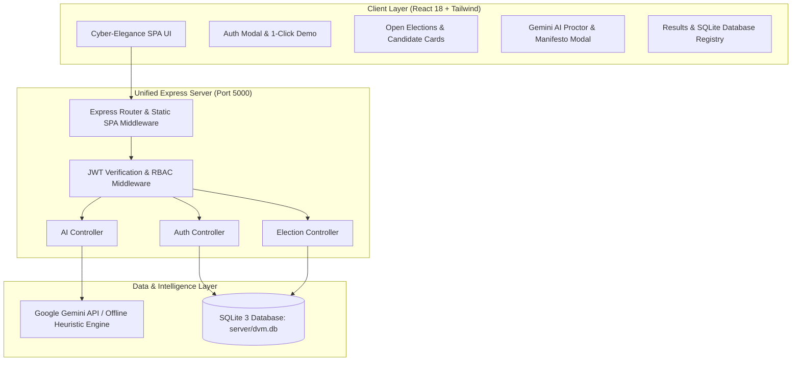
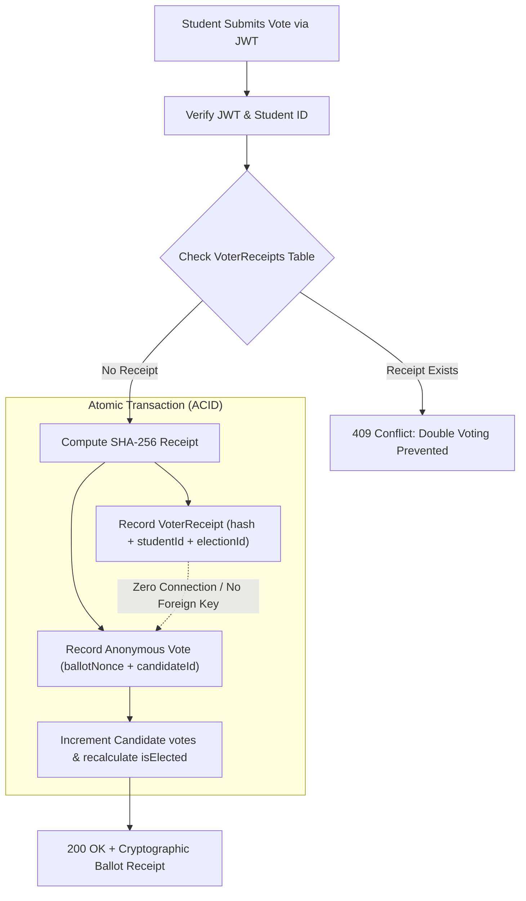
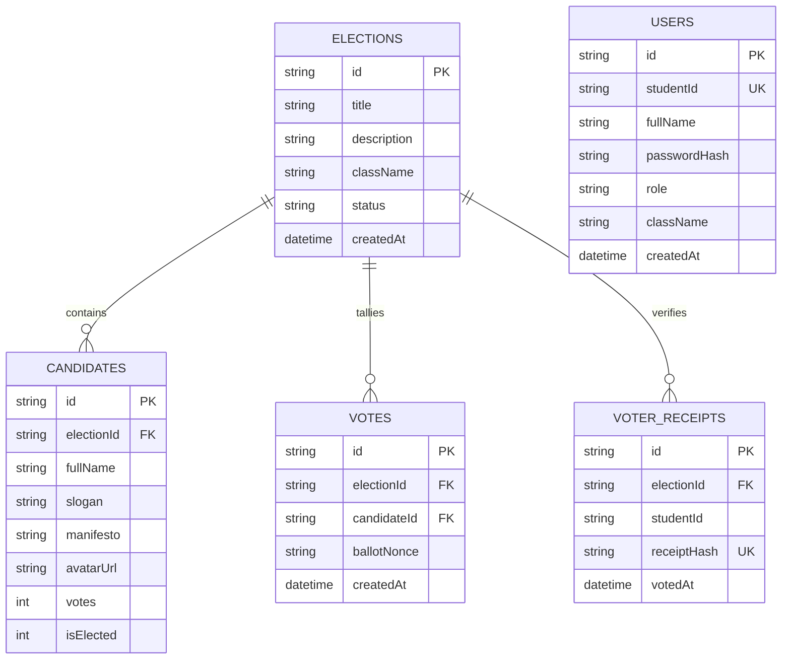

# 🗳️ Digital Voting Machine (DVM) — AI-Powered Elections

> **A production-grade, cryptographically secure digital voting web application tailored for Student Council, Class Monitor, and Class Representative (CR) elections. Featuring a Cyber-Elegance OLED dark aesthetic, decoupled anonymous ballot secrecy, persistent SQLite 3 storage, and deep Google Gemini 2.0 / 1.5 Flash AI integration.**

---

## 📑 Table of Contents
1. [Project & Problem Statement](#1-project--problem-statement)
2. [Third Party Libraries Used and APIs](#2-third-party-libraries-used-and-apis)
3. [AI Coding Assistants Used](#3-ai-coding-assistants-used)
4. [Architecture and System Design](#4-architecture-and-system-design)
5. [Directory Tree](#5-directory-tree)
6. [Security, Privacy & Browser Constraints](#6-security-privacy--browser-constraints)
7. [Quickstart Setup & Run](#7-quickstart-setup--run)

---

## 1. Project & Problem Statement

### 🎯 Overview
In schools, universities, and student-led organizations, Class Representative (CR) and Student Council elections are the foundational pillars of democratic student representation. However, conventional election methods are burdened with operational inefficiencies, social pressure, and a lack of voter engagement.

**Digital Voting Machine (DVM)** modernizes campus democracy into a tamper-proof, transparent, and AI-augmented digital voting experience.

### ⚠️ The Problem Statement
1. **Compromised Ballot Secrecy & Peer Pressure**: Traditional hand-raising or paper chits in classrooms subject students to severe peer pressure and surveillance. Students often vote for whoever their peer group favors rather than their preferred candidate.
2. **Double-Voting & Ballot Box Stuffing**: Paper chits are vulnerable to duplicate submissions, ballot stuffing, miscounts, and accidental loss during counting.
3. **Uninformed Voting & Superficial Popularity**: Candidate manifestos are typically long text documents that students rarely read. Consequently, voters cast uninformed votes driven by popularity, superficial charisma, or hasty last-minute biases.
4. **Zero Verifiable Cryptographic Proof**: Voters have no mathematically verifiable way to confirm their vote was registered without disclosing their confidential selection.
5. **Campaign Disparity & Lack of Mediation**: First-time student nominees lack the public speaking resources to articulate concise agendas, and administrators lack automated tooling to detect coordinated ballot spikes or voting fraud.

### 💡 The DVM Solution
- **Decoupled Cryptographic Anonymity**: Voter identity verification is isolated from ballot casting using irreversible SHA-256 receipts ($\text{Receipt} = \text{SHA-256}(\text{Student ID} + \text{Election Secret})$), ensuring zero linkage between voter identity and nominee choice.
- **Persistent ACID SQLite 3 Store**: Powered by native `node:sqlite` storing separate tables for `users`, `voter_receipts`, `candidates` (with automated `isElected` computation), `votes`, and `elections`.
- **Google Gemini AI Suite**:
  - *Manifesto Summarizer*: Condenses multi-page candidate manifestos into 3 clear commitments.
  - *Unbiased Nominee Comparison*: Provides a neutral side-by-side contrast of nominee agendas.
  - *Student Election Proctor*: Floating conversational assistant clarifying voting procedures, rules, and candidate backgrounds.
  - *60-Second Speech Generator*: Generates tailored, inspiring campaign speeches for student nominees.
  - *Gemini Fraud Sentinel*: Evaluates voting velocity and submission patterns to flag anomalous spikes.
- **Cyber-Elegance Dark Interface**: Tailored with OLED dark backgrounds, ambient glowing lamp fixtures, tricolor security accents, and locked pointer interactions for kiosk deployments.

---

## 2. Third Party Libraries Used and APIs

### 🖥️ Backend (Node.js & Express)
| Library / Tool | Version | Description & Purpose |
|---|---|---|
| **`node:sqlite`** | Native (v26.12+) | Native synchronous SQLite 3 database engine with ACID transactions and WAL mode. |
| **`express`** | `^4.19.2` | High-performance HTTP web framework serving REST endpoints and unified static SPA build. |
| **`@google/generative-ai`** | `^0.21.0` | Official Google SDK powering Gemini 2.0 Flash and Gemini 1.5 Flash models. |
| **`jsonwebtoken`** | `^9.0.2` | Stateless HMAC-SHA256 JWT generation and authentication for voter sessions. |
| **`bcryptjs`** | `^2.4.3` | Salted password hashing (10 salt rounds) for voter and administrator credentials. |
| **`cors`** | `^2.8.5` | Cross-Origin Resource Sharing middleware for flexible environment requests. |
| **`dotenv`** | `^16.4.5` | Zero-dependency environment variable loader. |
| **`tsx`** | `^4.19.0` | Lightning-fast TypeScript execution engine and dev runner. |
| **`typescript`** | `^5.4.5` | Static type checking and strict compiler guarantees across the backend. |

### 💻 Frontend (React & Vite)
| Library / Tool | Version | Description & Purpose |
|---|---|---|
| **`react`** | `^18.3.1` | Modern declarative component architecture and virtual DOM engine. |
| **`react-dom`** | `^18.3.1` | React DOM rendering engine for single-page web applications. |
| **`vite`** | `^5.3.4` | High-speed frontend build tool and Hot Module Replacement (HMR) development server. |
| **`tailwindcss`** | `^3.4.4` | Utility-first CSS framework with custom dark-mode radial gradients and neon lighting. |
| **`lucide-react`** | `^0.395.0` | Accessible vector icons (Vote, BarChart3, Bot, Sparkles, ShieldCheck, Lock, User, etc.). |
| **`canvas-confetti`** | `^1.9.3` | GPU-accelerated celebratory confetti particles rendered on successful ballot submission. |

### 🤖 External & Cloud APIs
- **Google Gemini API**:
  - `gemini-2.0-flash` (Primary): High-speed inference for real-time manifesto analysis and conversational proctoring.
  - `gemini-1.5-flash` (Secondary): Fallback tier for high-reliability token completion.
  - **Contextual Semantic Fallback Engine**: If an external API key is missing or network connectivity is unavailable, DVM automatically cascades to an internal heuristic engine that analyzes election rules, tie-breaker policies, deadlines, and candidate profiles dynamically without breaking the UI.

---

## 3. AI Coding Assistants Used

### 🧠 Google Antigravity Pair-Programming Agent
The development, architectural design, database structuring, and UI/UX refinement of DVM were orchestrated using the **Google Antigravity** advanced pair-programming agent:

1. **Autonomous Architecture & Full-Stack Implementation**:
   - Designed and built the unified single-port architecture where Express serves both API routes (`/api/*`) and the compiled Vite React single-page application from `client/dist`.
   - Engineered the decoupled ballot secrecy mechanism to guarantee voter privacy mathematically.
2. **Persistent Database Architecture**:
   - Migrated the data layer from transient in-memory arrays to persistent SQLite 3 (`node:sqlite`), creating tables for `users`, `voter_receipts`, `candidates`, `votes`, and `elections`.
   - Implemented real-time election status calculations, marking candidates with `isElected = 1` dynamically as votes are cast.
   - Built the multi-tab Database Registry inspector in the frontend to review `Elected Members`, `Users Table`, and `Voters Participation Ledger`.
3. **Prompt Engineering & Gemini Fallback Engine**:
   - Structured robust system instructions for Google Gemini models to enforce neutral election proctoring, JSON formatting, and 3-point bullet summaries.
   - Built a dynamic offline semantic analyzer that handles common student queries (rules, voter eligibility, tie-breakers, candidate backgrounds) when Gemini API keys are omitted.
4. **Cyber-Elegance Dark UI/UX Engineering**:
   - Designed custom dark aesthetic: deep OLED `#09090b` palette, subtle ambient wall lamp light fixtures, symmetrical glowing Indian tricolor lines, and non-intrusive interactive state animations.
   - Hardened UI security by applying `select-none` to prevent text-dragging during kiosk voting, while isolating `select-text` strictly to input fields.

---

## 4. Architecture and System Design

### 🏗️ Unified Port 5000 Architecture
DVM utilizes a unified monolith architecture where both the backend REST API and the frontend Single-Page Application run on **Port 5000**. In development, Vite can also run independently on **Port 5173** for hot-reloading.



---

### 🛡️ Decoupled Ballot Secrecy Mechanism
To guarantee that a vote can **never** be traced back to the student who cast it, DVM implements an atomic decoupled ballot flow:



- **Receipt Formula**:
  $$\text{Receipt} = \text{SHA-256}(\text{StudentID} + \text{ElectionID} + \text{Salt})$$
- The `voter_receipts` table proves *that* the student participated (preventing double-voting).
- The `votes` table records *the candidate vote* with a randomized nonce and **no reference** to the voter.

---

### 🗄️ Relational SQLite 3 Database Schema
The database (`server/dvm.db`) contains 5 relational tables:



---

## 5. Directory Tree

```
dvm/
├── prisma/
│   └── schema.prisma              # Database schema definition
├── server/
│   ├── src/
│   │   ├── controllers/
│   │   │   ├── aiController.ts    # Gemini API handlers (Summary, Compare, Proctor, Speech)
│   │   │   ├── authController.ts  # JWT registration, login, and profile retrieval
│   │   │   └── electionController.ts # Atomic vote casting, tallying, and database registry
│   │   ├── middleware/
│   │   │   └── authMiddleware.ts  # JWT bearer verification and Role-Based Access Control
│   │   ├── routes/
│   │   │   ├── aiRoutes.ts        # AI endpoints (/summarize, /compare, /assistant, /speech)
│   │   │   ├── authRoutes.ts      # Auth endpoints (/login, /register, /me)
│   │   │   └── electionRoutes.ts  # Voting endpoints (/active, /vote, /results, /database/all)
│   │   ├── services/
│   │   │   └── geminiService.ts   # Google Gemini 2.0 / 1.5 Flash SDK & fallback heuristics
│   │   ├── db.ts                  # SQLite 3 engine (node:sqlite) & automatic seeder
│   │   └── index.ts               # Unified Express server & Vite static SPA host
│   ├── dvm.db                     # Persistent SQLite 3 database file (auto-generated)
│   ├── package.json               # Backend dependencies and scripts
│   └── tsconfig.json              # Backend TypeScript configuration
├── client/
│   ├── src/
│   │   ├── components/
│   │   │   ├── AnimatedBackground.tsx # Ambient radial glow & floating particle aesthetics
│   │   │   ├── AuthModal.tsx          # Student/Admin login, registration & 1-click test fill
│   │   │   ├── GeminiAssistantModal.tsx # Floating election proctor chat widget
│   │   │   ├── GoogleAccountChooserPopup.tsx # Institutional SSO simulation popup
│   │   │   ├── HeroSection.tsx        # Cyber-Elegance hero, glowing CTA & wall lamp fixtures
│   │   │   ├── ManifestoModal.tsx     # AI 3-point manifesto distillation & candidate compare
│   │   │   ├── Navbar.tsx             # Brand logo, non-clickable pills & theme toggle
│   │   │   ├── OpenElectionsCard.tsx  # Live election card with candidate selection
│   │   │   ├── PitchGeneratorModal.tsx# Nominee 60-second speech generator
│   │   │   └── ResultsModal.tsx       # Live charts, Fraud Sentinel & SQLite Database Registry
│   │   ├── App.tsx                    # Client state coordinator & confetti feedback
│   │   ├── main.tsx                   # React 18 DOM root mount
│   │   └── index.css                  # Tailwind styles, glow filters, and selection locks
│   ├── dist/                          # Production build output (served by Express)
│   ├── index.html                     # HTML5 entrypoint with cyber fonts
│   ├── package.json                   # Frontend dependencies and Vite scripts
│   ├── tsconfig.json                  # Frontend TypeScript configuration
│   └── vite.config.ts                 # Vite proxy & build configuration
├── .env                               # Active environment configuration
├── .env.example                       # Environment template
├── .gitignore                         # Git ignore list (excludes node_modules, dist, *.db)
├── GEMINI.md                          # Repository maintenance and deployment guidelines
├── package.json                       # Monorepo root management scripts
└── README.md                          # Production system documentation
```

---

## 6. Security, Privacy & Browser Constraints

### 🔒 Cryptographic Ballot Secrecy
- **Decoupled Architecture**: Voter identities (`studentId`) are never stored in the same table as cast ballots (`votes`).
- **Mathematical Nonce Verification**: Every vote records an un-linkable cryptographic `ballotNonce`.
- **Public Audit Proof**: Students receive an irreversible SHA-256 receipt confirming participation without revealing candidate choice.

### 🛑 Anti-Double Voting Enforcement
- Synchronous, ACID-compliant database constraints guarantee that attempting to submit a second ballot returns an immediate `409 Conflict: You have already voted in this election`.

### 🛡️ Authentication & Authorization
- **BCrypt Password Security**: All student and administrator passwords are encrypted using `bcryptjs` with 10 salt rounds.
- **Stateless JWT Sessions**: Requests to authenticated endpoints require an `Authorization: Bearer <token>` header containing a digitally signed JSON Web Token.
- **Role-Based Access Control (RBAC)**: Distinct permissions ensure students cannot create elections or access administrative endpoints.

### 🖥️ Browser & Kiosk Interaction Constraints
To prevent accidental manipulation, drag-and-drop distortion, or tampering when deployed on shared classroom tablets, laptops, or voting kiosks:
- **`select-none` Protection**: Global UI text selection is disabled across the page, preventing accidental text dragging, highlighting, or browser gesture conflicts.
- **Isolated `select-text`**: Form fields (`<input>` and `<textarea>`) explicitly override selection with `select-text`, ensuring students can type, copy, and paste credentials effortlessly.
- **`pointer-events-none` on Decorative Badges**: Status indicators (e.g. `Vote for your REPRESENTATIVE`, `☆ ONE PERSON ONE VOTE ONE VALUE`, and decorative wall lamps) have `pointer-events-none` applied so they function purely as visual cues without intercepting touch or mouse events.
- **Non-Clickable Navbar Navigation**: Informational pill badges in the header display status without triggering confusing page reloads.

### 🚨 Gemini Fraud & Anomaly Sentinel
- Real-time algorithmic analysis checks the temporal distribution of ballot submissions:
  - Detects microsecond bursts indicative of automated bot attacks.
  - Flags suspicious voter concentration anomalies.
  - Computes an **Integrity Score (0-100%)** displayed inside the Results Modal.

---

## 7. Quickstart Setup & Run

### 📋 Prerequisites
- **Node.js**: `v18.0.0` or higher (`v20+` or `v26+` recommended)
- **npm** or **pnpm**
- **Google Gemini API Key** *(Optional — DVM includes an automated offline semantic engine)*

---

### ⚙️ Step 1: Clone & Configure Environment

```bash
# Clone the repository
git clone https://github.com/traza8460/dvm.git
cd dvm

# Copy environment variables
cp .env.example .env
```

Open `.env` in your text editor and insert your Gemini API Key:
```env
PORT=5000
NODE_ENV=production
JWT_SECRET=super-secret-dvm-jwt-key-2026
GEMINI_API_KEY=your_actual_gemini_api_key_here
```

---

### 📦 Step 2: Install Dependencies

```bash
# Install root, backend, and frontend dependencies
npm run install:all
```

---

### 🚀 Step 3: Build & Launch Unified Server

Build the React frontend and launch the unified server on **Port 5000**:

```bash
# Build the client SPA into client/dist
npm run build --prefix client

# Start the unified backend server
npm run dev:server
```

Now open **http://localhost:5000** in your browser.

> **💡 Developer Mode (Optional)**: If you prefer hot module reloading with separate ports, you can run:
> - Backend: `npm run dev:server` (Port 5000)
> - Frontend: `npm run dev:client` (Port 5173 with auto-proxy to 5000)

---

### 🔑 Pre-Configured Test Credentials

DVM automatically initializes the SQLite database (`server/dvm.db`) with active election data and pre-seeded test accounts:

| Role | Student ID | Full Name | Password | Capabilities |
|---|---|---|---|---|
| **Student (Voter)** | `STU2026-042` | Aryan Sharma | `pass123` | Cast 1 ballot, read manifestos, query Gemini proctor |
| **Admin** | `ADMIN-001` | Election Officer | `admin123` | Review live tallies, inspect Fraud Sentinel, access SQLite Registry |

*(You can also click **"Test Voter"** or **"Admin"** buttons in the Sign-In modal to instantly autofill credentials, or register a new student account using the Sign-Up tab).*

---

### 🔍 SQLite Database Inspection & Audit

You can inspect all stored tables (`users`, `voter_receipts`, `candidates` with `isElected`, and `votes`) in two ways:

1. **Via the In-App Database Registry**:
   - Open **http://localhost:5000** and click **"Results"** in the election card.
   - Click the 3rd tab: **"Database Registry (SQLite)"**.
   - Switch between **Elected Members**, **Users Table**, and **Voters Participation Ledger** to see real-time updates.

2. **Via SQLite CLI**:
   ```bash
   sqlite3 server/dvm.db "SELECT id, fullName, votes, isElected FROM candidates;"
   sqlite3 server/dvm.db "SELECT studentId, receiptHash, votedAt FROM voter_receipts;"
   ```

---

### 📡 REST API Reference

| Method | Endpoint | Authorization | Description |
|---|---|---|---|
| `POST` | `/api/auth/register` | Public | Register new student (`studentId`, `fullName`, `password`, `className`). |
| `POST` | `/api/auth/login` | Public | Authenticate voter or admin; returns JWT token and user profile. |
| `GET` | `/api/auth/me` | Bearer Token | Retrieve currently authenticated voter session. |
| `GET` | `/api/elections/active` | Public | Fetch current open election, candidate profiles, and manifesto summaries. |
| `POST` | `/api/elections/vote` | Bearer Token | Cast an atomic, decoupled ballot (`electionId`, `candidateId`). |
| `GET` | `/api/elections/:id/results` | Public | Fetch live vote tallies, percentages, and Gemini Fraud Sentinel analysis. |
| `GET` | `/api/elections/database/all` | Public / Admin | Returns complete SQLite tables (`users`, `voter_receipts`, `candidates`). |
| `POST` | `/api/ai/summarize-manifesto` | Public | Distill candidate manifesto into 3 high-impact commitments. |
| `POST` | `/api/ai/compare-manifestos` | Public | Generate a neutral, side-by-side comparison of candidate platforms. |
| `POST` | `/api/ai/ask-assistant` | Public | Interactive conversational proctor answering election & voting questions. |
| `POST` | `/api/ai/generate-speech` | Public | Draft a customized 60-second classroom campaign pitch for nominees. |

---

## 📄 License
This project is open-source and distributed under the **MIT License**.
